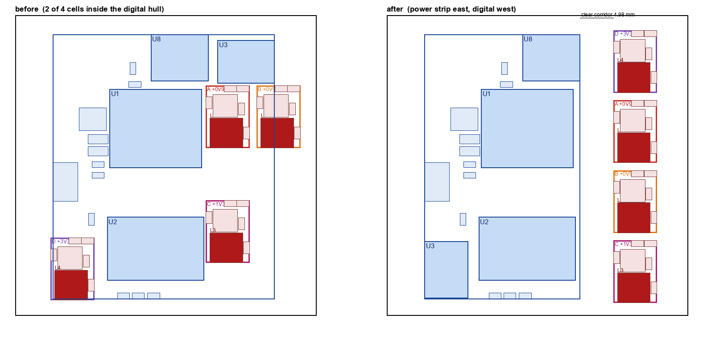

# 184 · RK3506 分阶段重做 —— 阶段 1d「电源/数字分区」与电感串扰取证

承接 `docs/181`（阶段 1 布局）、`docs/182`（阶段 1b 电源布局）、`docs/183`（阶段 1c 退耦缺件）。

用户原话：**「你有没有想过一个问题？电源和数字电路混合在一起会不会导致电感串扰ddr的问题？我一般布局电源和数字电路都是分两片区域布局的，你看看你现在的布局呢？」**

结论先说三句：

1. **会串扰，但磁场不是主因**——按这套板子的参数（屏蔽 4×4 电感、0.5 MHz、2 mm）感应到 DDR 走线上的电压是 **0.05–0.53 mV**，比 DDR3L 的 ~100 mV 接收裕量小两个数量级（§3 有算式）。真实的代价是**共地回流**、**扇出走廊**、**输入环路 di/dt 没有地方收紧**这三条。
2. **搬迁前的布局正是「四桶环绕」**：C 单元贴着 DDR 0.85 mm（焊盘级 2.121 mm）、A/B 单元压在 NAND 下方 0.33 mm，四个 buck 单元从西、东、南三面把 U1/U2 围住（§2）。
3. **MCP 缺的是一条判据**：三条磁件规则（`magnetic_keepout` / `_via_keepout` / `_deep`）问的都是「器件下面有没有铜」，没有一条问过「这个磁件离敏感器件多远」，所以「buck 贴着 DDR」在审计里读成干净。本版补上 `layout.magnetic_to_hs_digital`（P1 / 3.0 mm），并把同一个数字交给放置通道 `design_constraints.placement_clearances`（§4）。

搬迁已落地：四个 buck 单元搬到**东侧单列竖带**（x 33.90–40.39），U3 转 90° 搬去西南角，数字区留在中部。最差磁件–数字间距 **2.043 mm → 7.413 mm**，`placement_clearances.violations` 归零（§5–§6）。



---

## 1. 三问三答

| 问 | 答 | 数字 |
|---|---|---|
| 电感真的会串到 DDR 上吗？ | **能量级不够**。屏蔽电感在 2 mm 处对一条 10 mm × 0.1 mm 的 DDR 走线感应 0.05–0.53 mV，DDR3L 的接收裕量 ~100 mV ⇒ **最坏情况也差 190 倍**。把距离从 2 mm 拉到 7.413 mm 再降 50 倍（≤0.01 mV） | 0.53 mV vs 100 mV |
| 那「分区布局」还有意义吗？ | **有，但理由是另外三条**：① 开关环路下面的地回流和 DDR 的回流走同一块铜；② 一个 6.49 × 9.32 mm 的 buck 单元占掉 DDR 的扇出走廊；③ 输入环路 di/dt 在单元被夹在两个数字件中间时没有地方收紧。这三条都不在 mV 量级上，但都在「板子能不能一次过」上 | 见 §3 |
| 是 MCP 缺约束还是我布局手滑？ | **MCP 缺一条判据**。`magnetic_keepout`（器件下面有铜）、`magnetic_via_keepout`（器件下面有过孔）、`magnetic_keepout_deep`（相邻内层有铜）三条全绿，因为它们只问「铜在哪」，不问「器件在哪」。搬迁前 `layout.magnetic_to_hs_digital`（本版新增）读 **fail 2.043**，搬迁后 **pass 7.413** | fail → pass |

---

## 2. 取证 A：搬迁前到底是不是「两片区域」

判据用**焊盘边到边**（不用 courtyard，不用铜距离）：courtyard 只是库的画法（晶体 keep-out 已经为这个付过一次学费），而阶段 1b 之后 DDR 与电源区都没有铜，铜距离不可测。

### 2.1 磁件 → 高速数字件，全部 8 对（`measure.magnet_digital_pairs`）

| 对 | 搬迁前 (mm) | 搬迁后 (mm) |
|---|---|---|
| L1 → U1 | **2.043** | **7.413** |
| L3 → U2 | **2.121** | **7.616** |
| L4 → U2 | 4.225 | 8.108 |
| L2 → U1 | 9.643 | 9.924 |
| L3 → U1 | 10.853 | 18.359 |
| L1 → U2 | 12.420 | 12.892 |
| L2 → U2 | 16.013 | 7.493 |
| L4 → U1 | 16.808 | 21.994 |

（搬迁后 L2→U2 从 16.013 掉到 7.493 是**换了受害者**：L2 现在离 U2 更近、离 U1 更远，最差对仍 ≥7.4。表里每一行都是重算的，不是估的。）

### 2.2 单元级：四个 buck 是谁贴着谁

单元 = buck IC + 电感 + 输入/输出电容 + 反馈分压，bbox 取成员 courtyard 的并集（单元刚性 6.49 × 9.32 mm）。

| 单元 | 搬迁前 bbox | 最近数字件 | 间隙 | Y 向重叠 |
|---|---|---|---|---|
| A `+0V9_CPU` | 28.53,25.10 – 35.02,34.42 | U3（NAND） | **0.33 mm** | U1 8.80 / Y1 3.40 |
| B `+0V9_LOGIC` | 36.13,25.10 – 42.62,34.42 | U3（NAND） | **0.33 mm** | U1 8.80 / Y1 3.40 |
| C `+1V35_DDR` | 28.53,7.90 – 35.02,17.22 | U2（DDR） | **0.28 mm** | U2 **6.85（全长）** |
| D `+3V3` | 5.33,2.30 – 11.82,11.62 | U2 | 1.93 mm | U2 6.37 |

`+1V35_DDR` 那一路最难解释：它就是给 DDR 供电的 buck，单元却**整段贴着 DDR 的东边**，Y 区间与 U2 完全重叠（6.85 mm）——等于把开关节点和它的负载摆在同一列上，中间只隔 0.28 mm 的 courtyard。这就是「电源和数字混在一起」在这块板上的具体形态。

顺便记一条 courtyard 与焊盘的差别：L3 到 U2 courtyard 是 **0.850 mm**，焊盘到焊盘是 **2.121 mm**。任何用 courtyard 下结论的判据在这里会宽 1.27 mm。

---

## 3. 取证 B：磁场算术（为什么阈值是 3 mm，为什么场不是主因）

小环源（内部绕线环路 A_s）、电流 I、频率 f，在距离 r 处对一个面积 A_v 的受害环：

```
B(r) ≈ μ0 · I · A_s / (2π r³)          （轴向偶极近似）
V    = A_v · dΦ/dt ≈ A_v · 2πf · B     →  V ≈ A_v · f · μ0 · I · A_s / r³
```

代这块板的数：f = 500 kHz（四路 buck 的开关频率）、A_v = 10 mm × 0.1 mm = 1 mm²（DDR 走线 0.1 mm 宽、距参考面 0.1 mm）、屏蔽 4×4 电感取内部环路 A_s = 2…9 mm²、纹波电流 I = 0.3…0.75 A：

| r | V（区间） |
|---|---|
| 2.0 mm | 0.047 – 0.530 mV |
| 3.0 mm | 0.014 – 0.157 mV |
| 5.0 mm | 0.003 – 0.034 mV |
| 7.413 mm（本版搬迁后最差） | 0.001 – 0.010 mV |

DDR3L 的接收裕量按 ~100 mV 算：**最坏情况仍差 190 倍**。所以：

- 这条规则**不是**在防磁耦合越限，它防的是「把一个开关单元塞进退耦/扇出/回流都还没地方放的位置」。why 文本里写的就是这三条，不假装做了电磁仿真。
- 阈值 **3.0 mm** 与 `layout.decoupling_max_distance_to_pin_mm` 同一个尺度（本仓库的默认尺度），不是算出来的最优值；6 mm 只做**报告项**写进 fact 的 `note`，不做第二条规则——一个事实两条规则等于刷条数。
- **反向验证**：如果把 A_s 和 I 都取到区间上限、把 r 压到 1 mm，V ≈ 4.2 mV，仍然差 24 倍。结论对参数不敏感，这是这条判据敢用「放置代价」而不是「场强上限」表述的原因。

---

## 4. MCP 补强

### 4.1 新事实 `magnetic_to_hs_digital_min_mm`

`ruleset/measure.py`：

- 加害者 = **有焊盘落在 switch-node 网上的磁件**（`_SWITCH_NODE_TOKEN` 认 SW / SWN / SWITCH / PHASE / LX）。FB1/FB2 挂在模拟馈电上，磁场安静，不算。
- 受害者 = **非连接器、且有 ≥3 个高速接口焊盘**的器件（`_HS_DIGITAL_TOKEN` 认 DDR / DQS / MIPI / RMII / RGMII / SGMII / PCIE / USB / SDMMC / LCD / ETH / CLK / OSC / LVDS / HDMI / EMMC / SDRAM）。J1 有 86 个敏感焊盘，算进来讲的是「对外接口在哪」而不是板内耦合，排除。
- 度量 = **焊盘矩形边到边**，板上取最差的一对；`note` 里报 6 mm 以上是否全部满足。

本轮把扫描抽成三个可复用的 helper：`_magnet_digital_scan`（→ mags / victims / skipped）、`_nearest_pair_per_magnet`、**`magnet_digital_pairs`**（全部 (磁件, 器件, 间距) 按间距升序）。**测量事实与放置通道用同一份扫描**，不许各自实现一遍——否则 audit 和 placement 会给出两个答案。

### 4.2 新规则 `layout.magnetic_to_hs_digital`

`calc/rules.py`：`isolation` / **High** / `mm` / `min` / **3.0**，why 里带上面那段算术的结论（场差两个数量级、真实代价是回流/走廊/di-dt）。

`ruleset/projection.py`：状态落 **`layer_policy / not_wired`**，理由是缺席的通道决定了状态——把 3 mm 光环当**铜禁布**（`rect_keepout / projected`）会连 DDR 自己的扇出都禁掉，因为这条规则禁的是**器件挨着器件**，不是铜挨着铜；只有会移动器件的 actor 能遵守。同一段文字里点名 `design_constraints.placement_clearances` 已经把同一个数字交给放置步骤。规则总数 27 → **29**（含 `layout.hf_per_rail`），`tools.py` 与 `docs` 的条数门同步。

`ruleset/audit.py`：`_CATALOG_LEVEL["layout.magnetic_to_hs_digital"] = "P1"`。

### 4.3 新放置通道 `design_constraints.placement_clearances`

从 `LAYOUT_RULES` 读 limit（单一来源，不写死 3.0），返回：

```
{rule, limit_mm, pairs:[{magnet, part, gap_mm, limit_mm, short_mm, action}], violations, method}
```

`violations` 只装 `short_mm > 0` 的行，`action` 是给 mover 的一句话（`move the magnet away`）。搬迁前读 `[L1→U1 2.043 short 0.957, L3→U2 2.121 short 0.879]`，搬迁后 `[]`。

### 4.4 测试（反向对照）

`tests/test_layout_facts.py::TestMagneticToHsDigital` 5 例，全部是**合成板**上的反向对照：

| 用例 | 期望 | 钉住的是什么 |
|---|---|---|
| 磁件贴着 DDR | 2.65 / fail，`parts[0]['magnet'] == 'L1'` | 能报出是谁 |
| 磁件贴着 rail 侧焊盘（x=5.0） | 0.95，最近的是 **rail 焊盘**不是 SW 焊盘 | 加害者按「磁件」算，不按「SW 焊盘」算 |
| 磁珠没有 SW 节点 | `unmeasurable` | 不把安静的磁珠算成开关源 |
| 只有连接器在附近 | `unmeasurable` | 连接器不做受害者 |
| 磁件放到 20 mm 外 | 15.95，`note` 说「every switching magnet is 6 mm or more」 | 距离算对、报告项也对 |

条数门 28 → 29（`tests/test_rule_projection.py` / `tests/test_skills.py`）。受影响面 `test_layout_facts + test_rule_projection + test_design_constraints + test_skills` = **111 passed / 1.17 s**。

---

## 5. 方案与落地

### 5.1 为什么是「东侧单列竖带」

| 方案 | 结果 | 判 |
|---|---|---|
| 2×2 方阵（x 29.1–42.4） | 西列磁件离 U1 只有 3.5 mm、离 DDR 0.95 mm | 换个位置违规，**否** |
| 三个单元去东带、D 留西南 | D 仍 4.2 mm 不到 6 mm，且做不到「两片区域」 | **否** |
| U3 不动、只搬三个 | 与第 4 个单元位冲突，且 U3 的 3V3 域就落在电源带里 | **否** |
| **东侧单列竖带 + U3 转 90° 搬西南角** | 四单元纵向堆叠，数字区完整留在中部，走廊 4.98 mm | **采用** |

竖带的 x0 = 33.90（四个单元共用），纵向 y0 = 1.90 / 12.40 / 22.90 / 33.40。U3（W25N01GV）占 x 30.25–38.75 / y 34.75–41.25 是挡住竖带放满四个单元的唯一障碍，转 90° 后 6.5 × 8.5 mm 正好放进 D 腾出的西南角（中心 8.90, 6.85）。

### 5.2 五个器件的位移

| 器件/单元 | Δx | Δy | Δrot |
|---|---|---|---|
| A `+0V9_CPU`（7 件） | +5.37 | −2.20 | 0 |
| B `+0V9_LOGIC`（7 件） | −2.23 | −12.70 | 0 |
| C `+1V35_DDR`（7 件） | +5.37 | −6.00 | 0 |
| D `+3V3`（7 件） | +28.57 | +31.10 | 0 |
| U3 W25N01GV | −24.60 | −32.15 | **90°** |

用 `move_cluster`（绕 cluster 质心旋转、框内铜随动）；**先 `delete_copper` 清带再搬**：`move_cluster` 会把「整段在框内」的外来铜一起拖走，而框内有 RMII / MIPI / SDMMC 穿行，硬拖等于把别人的线拽成麻花。

### 5.3 落地后的分区

- 电源带：x 33.90–40.39、y 1.90–42.72，**四个单元 + 8 颗电容 + 8 颗电阻，全部在内**，带内当前 0 段铜、0 个过孔（布线在阶段 3）。
- 数字区：U1（14.10–27.90 / 22.10–33.90）、U2（13.75–28.25 / 5.25–14.75）、U8、U3、Y1 与时钟件，全部在 x ≤ 28.92。
- 中间走廊：33.90 − 28.92 = **4.98 mm** 全空。
- 单元级最近距离：A→U8 5.75、B→U2 5.65、C→U2 5.65、D→U8 4.98 mm。

---

## 6. 读数

`tools/board_loop.py --board … --baseline D:/tmp/_rl1_1d.base.json`（round-trip 含官方 `ZONE_FILLER` 重灌）：

| 指标 | 基线（搬迁前） | 现状（`_rl1_s1d`） | 说明 |
|---|---|---|---|
| `layout.magnetic_to_hs_digital` | **fail 2.043** | **pass 7.413** | 本版新增，本节主判 |
| `placement_clearances.violations` | 2 条 | **0 条** | 同上 |
| `drc_error` | 6 | **26** | 25 × `track_dangling` + 1 × `isolated_copper`；**0 short / 0 clearance / 0 mask_bridge** |
| `unconnected` | 178 | **225**（+47） | 清带切断的网，阶段 3 重布 |
| `via_in_pad`（盘中孔） | 18 | **9**（−9） | 搬走的单元里原有 9 个盘中孔 |
| 铜对象（track+via） | 2339 | 1743 | 清带代价 |
| `shape` / `place` | shape_fail(dead_end) / place_fail(hole_in_pad, copper_under_magnetics) | 同 | 未变，属阶段 3 清单 |

审计整体仍是 `blocked_at_P1`——但卡的是 `connectivity_complete`（225）与 `hf_per_rail`（8 域 0 颗 100 nF，见 `docs/183`），不是本轮这条。

---

## 7. 铜债（不藏在正文里）

1. **25 条 `track_dangling` 是「半边路由」，删不得也补不得**
   LCDC×2、MIPI×2、USB0×2、SARADC×2、RMII0×2、RMII1×11、FSPI×2，长度 0.28–2.88 mm，全部落在被清掉的两条带上：它们本来是 U1/U2 到 J1 / U3 的整条线，中间被切掉，两端各留一个断头。
   **测过删**：带 `--max-len 100` 连删 12 轮，每轮删 12–24 段、DRC 条数先降后持平（24 → 12 就不再动），累计吃掉 **203 段**真铜，`unconnected` 一分不降（225 → 225）——说明它们不承载任何连通性，但删它们会一路把邻段变成新的断头。已回滚到「只删 ≤0.25 mm 碎屑」的版本（剪掉 16 + 11 + 41 = 68 段，`unconnected` 全程 225 不动）。
2. **1 块孤岛铺铜**（`+1V35_DDR` / In3 / 优先级 1，位于 12.8,−3.0）是阶段 1b 遗留，等 DDR 缝合孔（阶段 2）重塑该 zone 时一并消掉。
3. **电源旧铜 62 段还在板内旧位置**（`+0V9_LOGIC` 46、`+3V3` 14、`+5V_IN` 2），一端仍接 SoC 球、另一端悬在空处但不报 dangling；电源带内 **0 段 0 孔**。阶段 3 按同构单元模板重布（Cin→VIN 短粗、SW→L 最短、L→Cout、FB 取 rail 平面、GND 就近下缝合孔）。
4. **`+5V_IN` 的 In3 铺铜只有东南角一块矩形**（40.2,−37.2 – 44.3,−43），四个单元的输入都在 x 34.9–38.6、y 1.9–42.7，中间没有铜；阶段 3 要把这块扩成沿竖带的一条母线。
5. **`+1V35_DDR` / `+3V3` 的 In3 多边形还是搬迁前画的**，与新的单元位置不对应（`+1V35_DDR` 的 x 上界 36.5 已经伸进电源带，`+3V3` 覆盖 y 0.5–20.7 也压住 L3/U5/U6 的位置）。重塑只在官方 `ZONE_FILLER` 下做，不自研灌注。

---

## 8. 没做的（明确登记）

- **不做第二条「分区」规则**。用户说的「两片区域」在这一版被落成「每个开关磁件到每个高速数字件 ≥3 mm」+「6 mm 报告项」，理由是同一个事实写两条规则等于刷条数。区域级的量（例如「buck 单元并集 bbox 是否与数字区 bbox 相交」）**本轮量过但没有立规则**：搬迁前后二者都是 0% 相交（单元从来不是压在数字件上，而是贴在三面），它分不出好坏，立了就是一条永远绿的规则。
- 阶段 2 DDR 布线、阶段 3 其余重布（含 `docs/183` §7 的 C19–C26 八颗 100 nF）未开工。
- 交付板 `rk3506_som.kicad_pcb` 本阶段未改动，工作副本 `_rl1_s1d.kicad_pcb` / `.kicad_pro`（`_` 前缀不入库）。

---

## 9. 复现

```bash
cd /d/工作/git_project/pcb_agent_mcp

# 事实 / 放置通道（前后对照）
env -u PYTHONPATH -u PYTHONHOME python -c "
import sys; sys.path.insert(0, r'src')
from pcb_agent_mcp.adapters.kicad_pcb import parse_board
from pcb_agent_mcp.ruleset.design_constraints import placement_clearances
for f in (r'D:/tmp/_rl1_pre1d.kicad_pcb', 'examples/rk3506_som/_rl1_s1d.kicad_pcb'):
    pc = placement_clearances(parse_board(f))
    print(f, pc['limit_mm'], pc['violations'])"

# 闭环读数（含官方 ZONE_FILLER 重灌 + DRC）
env -u PYTHONPATH -u PYTHONHOME D:/KiCad/10.0/bin/python.exe -u tools/board_loop.py \
    --board "D:/工作/git_project/pcb_agent_mcp/examples/rk3506_som/_rl1_s1d.kicad_pcb" \
    --baseline D:/tmp/_rl1_1d.base.json --json

# 受影响面测试
env -u PYTHONPATH -u PYTHONHOME python -m pytest tests/test_layout_facts.py \
    tests/test_rule_projection.py tests/test_design_constraints.py tests/test_skills.py -q

# 出图
env -u PYTHONPATH -u PYTHONHOME python D:/tmp/_draw_s1d.py
```
