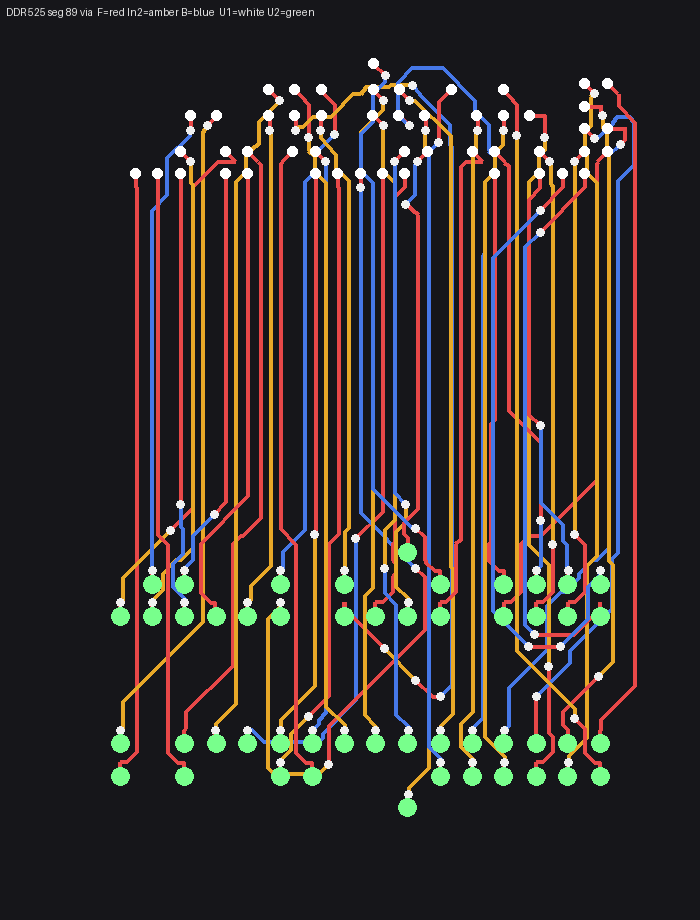

# 185 · RK3506 分阶段重做 —— 阶段 2「DDR 布线」

承接 `docs/181`（阶段 1 布局）、`docs/182`（1b 电源布局）、`docs/183`（1c 退耦缺件）、`docs/184`（1d 电源/数字分区）。
工作副本 `examples/rk3506_som/_rl1_s1d.kicad_pcb` + 同名 `.kicad_pro`（`_` 前缀，不入库）；交付板 `rk3506_som.kicad_pcb` 本阶段不动。

结论先说四句：

1. **50 条 `/DDR_*` 全部布通，且是电气意义上的通**：`kicad-cli pcb drc` 的 `unconnected_items` 里 **`/DDR_*` 零条**（整板还剩 175 条，全是 GND stitching 与非 DDR 网的老账）。
2. **几何是干净的**：`clearance 0 / via_dangling 0 / hole_to_hole 0 / via_in_pad 0`；剩 26 条全是阶段 1 之前就存在的 `isolated_copper 1` + `track_dangling 25`。整板 1950 段铜的角度直方图**只有四个值**（0°/45°/90°/135°），一条斜线都没有。
3. **等长没做到，而且不是"再补几刀蛇形"能做到的**：三条差分对内偏差 0.4257 / 0.8986 / 0.4864 mm（tol 0.25），lane0 最差 11.3033 mm（tol 0.50）。根因被实验钉死为**走廊容量**而非布线顺序（§7）。
4. **本轮改了引擎五处**，其中三处是"能跑但答案是错的"那一类（§3）。每条都带反向失败对照（§9）。



---

## 1. 这一阶段为什么先做"布通"而不是先做等长

等长只能**加长**（`docs/173` 已把这条写成常量：45° 锯齿每 1 mm 路径换 `(2−√2)/2 = 0.4142 mm`，与振幅无关）。
所以一条网如果比同组最长的那条短 11 mm，蛇形要凭空补 11/0.4142 ≈ 26.6 mm 的中心线长度——那不是调，是重布。

顺序只能是：**先让 50 条都在合法路径上通**，再拿实测长度说话；长度差距大到蛇形补不了，如实报 `needs_mm`，不回填。

---

## 2. 逃逸（fan-out）先做，且是枚举出来的

BGA333 的球在 0.5618 mm 节距上，DDR3L 是 0.8 mm 节距的双排 96 球。布线器不负责"从球心钻出来"，所以先把 50 条网两端的逃逸孔摆好（`D:/tmp/_esc6.py`）：

| 项 | 值 | 为什么 |
|---|---|---|
| 探测下界 `FLOOR` | 0.15 mm | 逃逸孔到异网焊盘的最近距离下限 |
| **`MIN_STUB`** | **0.32 mm** | **盘中孔禁令的量化**：孔心到焊盘铜边缘的桩长必须 ≥ 0.32 mm，否则等于在焊盘上打孔（`via_in_pad` 是硬红线） |
| 路由层 | `F.Cu / In2.Cu / B.Cu` | In1/In4 是 GND zone，In3 是电源 zone，不让信号穿 |
| 枚举口径 | 全部合法点全枚举，**稀缺优先** | 先占"只有一种钻法"的球，再占选择多的球 |
| 结果 | **50 网双端、0 fails、200 个 op** | 每个端点一个 through via（`size 0.2 / drill 0.1`） |

一个必须写下来的口径坑：布线落在 0.05 mm 栅格节点上，与逃逸孔心最多偏 0.035 mm，所以**判"这条网用到了这个孔"不能用端点相等**，要用"点到线段距离 ≤ 孔半径 + 半线宽"。§6 剪孔就是按这条判的。

---

## 3. 引擎的五处修正（都在 `route/grid.py` 与 `route/router.py`）

### 3.1 探测圆 16 边 → 64 边（几何是正确性问题，不是速度问题）

16 边形内接于圆，最多比真圆小 `r(1−cos(π/16)) = 1.9%`。0.2 mm 的孔就是 **1.9 µm 的乐观**——于是"刚好在规则上"的一对孔被放行，`kicad-cli pcb drc` 回头报 **0.0987 mm**（规则 0.1）。64 边把这个误差压到 0.12 µm。`add_via` 写进栅格的 occupancy 多边形同样 16 → 64（否则栅格说空、精确门说撞，同一件事两把尺子）。

### 3.2 判"正好在规则上"的孔必须放行

规则说的是「间距 ≥ 0.1 mm **合规**」。`circle_points` 把顶点放在 0° 上，正交情形量出来**恰好等于** `need`——浮点减法会把它算成 `0.09999999999999998`。判据因此是 `d >= need - 1e-6`：
- `-1e-6` 只抵浮点误差，**不是设计余量**；
- 真余量在上游买：本轮布线参数用 `clearance_mm = 0.105`（§4）。用"判定端加 5 µm"去买余量的做法**试过并被否掉**——它会把"正好在规则上"的合法扇出全判死，50 网里掉 11 条。

### 3.3 A* 不许在目标节点上打孔

原先的搜索允许"在 goal 节点放一个零成本过孔"就算到达。在 `/DDR_DQ9` 上它的实际后果是：搜索沿 F.Cu 走到**预先摆好的逃逸孔**节点，打一个孔"到达"，然后这条网回来是 `routed`，但那个逃逸孔只有一层铜 ⇒ `via_dangling`。
判据改成：goal 必须**用自己接受的层上的铜**到达。

```python
if node in goal_layers:
    continue          # 见 dir
```

### 3.4 `terminal_override` 支持"自由到达任意层"

`terminal_override` 原本只收坐标（钉在默认层）。本轮扩成 `{"at": [x, y], "layers": [...]}`，并打 `pinned` 标。
两条配套：`_via_covers` 的容差改成 `pitch*1.5 = 0.075`（把 `hole_to_hole` 从 12 条压到 0）；`_route_signal_net` 只允许在 `pin_layers` / `seed_layers` 内起步。

**这条路是试出来的，不是设计出来的**（见 §5 的负结果）。

### 3.5 新增 `net_priority`

`work` 原本按 MST span **倒序**（最长先布）。`net_priority` 允许按给定 rank 把指定网提到最前——注意语义是"**把被自己布长了的网重布**"，不是"替布线器挑捷径"，所以它只在参数里显式给出，不默认启用。

### 3.6 `diameter` 别名必须被拒

`add_via` 的字段是 `size`。传 `diameter` 时旧代码**静默回退到默认 0.2**——一条本该是 0.25 的孔变成 0.2，DRC 看起来还干净。`edit/ops.py` 的 `_PARAM_ALIASES` 现在对这种"看起来像参数、其实是另一次调用"的键直接返回 `ARG_ALIAS`。

---

## 4. 布通实测

```
plan(Board, pitch_mm=0.05, layers=[F.Cu, In2.Cu, B.Cu],
     nets=50 条 /DDR_*,
     clearance_mm=0.105, track_mm=0.1, via_diameter_mm=0.2, via_drill_mm=0.1,
     edge_clearance_mm=0.3, congestion_rounds=…, rip_up_rounds=…,
     second_sweep=True, terminal_override={n: [{"at": u1}, {"at": u2}]})
```

| 读数 | 值 |
|---|---|
| 网数 | **50 / 50 routed，0 failed** |
| op | **461**（`add_track` 425 + `add_via` 36） |
| emit 精确门拒掉的候选段 | **2**（不在 461 里；50 网仍全通） |
| 耗时 | **64.632 s**（`rips 3`、`sweeps 2`） |
| 栅格 | 811,801 cell @ 0.05 mm；`edge 0.3 mm` 让 37,973 个 cell 对所有网关闭 |
| 落盘 | `edit.propose` → `apply_plan(confirm=True, allow_new_violations=True)`，**0 rejected** |

### 4.1 层分布（50 条网各用了哪些层）

| 用的层 | 网数 |
|---|---|
| `F.Cu + In2.Cu` | 20 |
| `F.Cu + B.Cu` | 16 |
| 只在 `F.Cu` | 10 |
| `F.Cu + B.Cu + In2.Cu` | 4 |

**这张表是本阶段最大的妥协**：44 条网碰到 F.Cu，而设计意图是 DDR 主要走内层。原因是 §5 的负结果——把两端钉在内层会让 3–4 条网必掉。

---

## 5. 负结果 A：钉内层 ⇒ 3–4 网必掉

最符合设计意图的做法是把终端钉在 `["In2.Cu", "B.Cu"]`（不占表层），实测 12 网一轮里 **3–4 网失败**，失败原因统一是：

```
emit: clearance  actual 0.1 / needed 0.1 / short_by 0.0
```

机制是**两把尺子的口径分裂**：A* 的 `_via_gate` 是**栅格**门（手里只有 occupancy 多边形，天然乐观），emit 的 `via_blockers` 是**精确**门（拿真几何量）。缺陷宽度 0.0999 mm 时栅格说"能过"、精确门按 0.1 说"不能"。
`rip_up_rounds` 从 1 提到 3 也没救，反而变成 **8/12 通过 + 224 s**——因为拆了重布会振荡。

⇒ 改成"自由终端 + 事后剪冗余逃逸孔"：`terminal_override` 不带 `layers`，让搜索自由到达任意层，**50/50、64.6 s、461 op**；代价是部分网跑在 F.Cu（§4.1）。

---

## 6. 剪掉 47 个冗余逃逸孔

`_prune_esc.py` 判据：对每个逃逸孔，若**没有任何一段铜**同时落在"该孔半径 + 半线宽"以内且**覆盖两层以上**，这个孔就没在载流 ⇒ 可删。

- 实测删 **47** 个（apply **0 rejected**），DDR 过孔从 136 降到 **89**（整板 407）。
- 为什么删了还连通：逃逸孔是 through via，焊盘的 F.Cu stub 与路由器在 F.Cu 上的走线**在同一点相遇**，删掉孔只是删掉"多余的跨层"，不切铜。
- **删完必须重灌 zones**，否则 DRC 报 161 条 `clearance 实际 0.0000`（对峙的是 `(2.0,−0.5)` / `(12.8,−3.0)` 的 zone 锚点）。`board_loop.refill()` 走官方 `ZONE_FILLER` 灌 4 个 zone 之后立刻归零。

---

## 7. 负结果 B：总有一条网必须绕 10–21 mm ⇒ 是容量，不是排序

单看"布通了"没有意义，要看每条网多走了多少：`excess = routed − straight`（straight 是两焊盘的直线距离）。

| 网 | straight | routed | excess |
|---|---|---|---|
| `/DDR_DQ1` | 11.24 | 22.00 | **+10.76** |
| `/DDR_DQ7` | 12.56 | 22.63 | **+10.07** |
| `/DDR_A8` | 10.30 | 15.66 | +5.36 |
| `/DDR_BA2` | 15.81 | 19.76 | +3.96 |
| `/DDR_A14` | 11.07 | 13.94 | +2.88 |
| …… 其余 45 条 | | | −0.5 … +2.1 |
| **合计** | | **720.0** | **+31.8** |

于是做了一次 `net_priority` 实验（把被布长了的网提到最前重布）：

| 实验 | 被提到最前的网 | 结果 |
|---|---|---|
| free2（采信） | `DQ1,DQ7,A8,BA2` | max excess **23.33 mm**（DQ7），合计 31.8 |
| free4 | `DQ0,DQ1,DQ7` | max **35.79**，DQ0 吃 **+21.14** |
| free5 | `DQ0,DQ5,DQ7` | max **35.79** |

**结论是负面的、也是本轮最值钱的一条**：无论怎么排，**总有恰好一条网要吃 10–21 mm 的绕行**。这不是排序问题，是**走廊/U2 逃逸出口的容量问题**——50 条网抢同一批出口，最后一个拿到的必然绕远。采信 free2（合计 31.8 最小、max 最小），不是为了好看，是因为它把代价压到最低。

---

## 8. 等长实测（未达标，如实报 `needs_mm`）

`edit.checks.length_match(tol_pair=0.25, tol_lane=0.5, tol_cmd=1.0)`，参考值取**组内最长**（蛇形只能加长）：

| 组 | 参考 | 最差 | 偏差 | 容差 | 判 |
|---|---|---|---|---|---|
| `DQS0P/DQS0N` | — | — | **0.4257** | 0.25 | fail |
| `DQS1P/DQS1N` | — | — | **0.8986** | 0.25 | fail |
| `CLKP/CLKN` | — | — | **0.4864** | 0.25 | fail |
| `lane0` | 23.3347（DQ7） | DQ5 12.0314 | **11.3033** | 0.50 | fail |
| `lane1` | 17.1163（DM1） | DQ10 10.6849 | **6.4314** | 0.50 | fail |
| `addr/cmd vs CLK` | 20.4684（组内最长） | CKE | **9.9299** | 1.00 | fail |

lane0 的实数（checks 口径）：`DQ0 17.087 / DQ1 22.6968 / DQ2 15.6506 / DQ3 13.0542 / DQ4 16.8678 / DQ5 12.0314 / DQ6 16.1435 / DQ7 23.3347 / DM0 12.7485`。

`needs_mm` 是"蛇形要补多少"，不是"我觉得"。lane0 要补 11.30 mm ⇒ 中心线要长 27.3 mm（÷0.4142）；`plan_meander` 已经量过这块板上 DDR 蛇形带 `35/39` 放不下（`docs/173`），**所以这里不画蛇形，如实登记为未达成**。

### 8.1 一个口径不一致要记下来

`_score.py`（两焊盘中心直线距离口径）与 `checks.length_match`（铜长度口径）对同一条网的读数不同：DQ7 分别是 22.63 与 23.3347。差的是**焊盘内的桩长与过孔跨层**。两张表不能混引：§7 讲"绕了多远"用前者（同口径相减），§8 讲"等不等长"用后者（它就是判据本身）。

---

## 9. 每处修正的反向失败对照

| 修正 | 反向对照 | 结果 |
|---|---|---|
| 探测圆 64 边 | 退回 16 边重跑 | 有网在 `kicad-cli pcb drc` 报 0.0987 mm（规则 0.1） |
| `need - 1e-6` | 改回 `need + 0.0` | `tests/test_route.py::…gap_is_measured_here` 失败（正好在规则上的孔被拒） |
| `need + 0.005`（试过，已否） | — | 合法扇出被判死，50 网掉 11 条 |
| goal 节点禁打孔 | 去掉这三行 | `/DDR_DQ9` 回来是 `routed` 但 `via_dangling` |
| `_via_covers` 容差 0.075 | 容差 0 | `hole_to_hole` 12 条 |
| 剪冗余逃逸孔 | 不剪 | 47 个孔只有一层铜载流（DRC 不报，但工艺上是白打的孔） |
| 加孔后重灌 zone | 不灌 | `clearance 实际 0.0000` × 161 |
| `ARG_ALIAS` 拒 `diameter` | 不拒 | 孔静默变 0.2，DRC 照样干净（**静默错答案**） |
| `net_priority` | 不传 | 顺序由 MST 决定，被布长的网没人管 ⇒ 这正是 free2 之前的状态 |

回归：`pytest tests/test_route.py tests/test_route_fixed.py tests/test_45_corners.py tests/test_fidelity.py` = **151 passed**（97.86 s）；
`tests/test_edit.py + test_ops_edit.py + test_ops_cluster.py` 同批 **305 passed**（首批含 `test_route` 失败，已按 §3.2 修）。

---

## 10. 板上现状（DRC，`kicad-cli pcb drc --severity-all`）

| 项 | 数 | 性质 |
|---|---|---|
| `violations` | **26** | `isolated_copper 1`（`(12.8,−3.0)` 的 `+1V35_DDR` In3 孤岛，阶段 1 之前就在）+ `track_dangling 25`（阶段 1 遗留 LCDC/MIPI/USB/SARADC/RMII/FSPI） |
| `clearance` | **0** | 本轮成果 |
| `via_dangling` | **0** | 本轮成果（§3.3） |
| `hole_to_hole` | **0** | 本轮成果（§3.4） |
| `via_in_pad` | **0** | 本轮成果（`MIN_STUB`） |
| `unconnected_items` | 175 | **其中 `/DDR_*` = 0**；其余全是 GND stitching 与其他非 DDR 网 |
| 铜段角度 | 1950 段，直方图只有 0°/45°/90°/135° | 无斜线、无锐角 |

---

## 11. 没做到的，以及下一步的第一步

1. **等长未达标**（§8）。真因不是"蛇形画得不好"，是 §7 的容量问题：**lane 内网长本来就分散 12–23 mm**。
   下一步不是 `tune_board`，而是**同拓扑 bundle 布线**：一条 lane 的 9 条网必须走同一条走廊、同一种拐弯序列，先把"结构等长"做出来，再让蛇形补最后 1–2 mm。当前布线器是**逐网独立 A***，它天然给不出等长结构——这是 MCP 缺的能力，不是参数没调好。
2. **44/50 条网碰 F.Cu**（§4.1）。这是 §5 那个妥协的账单。要回到"内层为主"，必须先修 A* 栅格门与 emit 精确门的口径分裂（栅格门要拿真几何，不能再靠 `clearance_mm` 参数买余量）。
3. 阶段 3 仍未开始：C19–C26 八颗 0402 100nF（`docs/183` 的缺件）、电源区走线、5 处半路由、`hole_in_pad`、`copper_under_magnetics`、旧锐角、旧的 9 条 `via_in_pad`、In3 zone 重塑。

---

## 12. 复现

```bash
# 逃逸（枚举，落 _ddr_esc6.json）
"D:/KiCad/10.0/bin/python.exe" -u D:/tmp/_esc6.py

# 布线（落 _route_free2.json）
"D:/KiCad/10.0/bin/python.exe" -u D:/tmp/_route_free.py <board> 3 1 "DQ1,DQ7,A8,BA2"

# 落盘
env -u PYTHONPATH -u PYTHONHOME python D:/tmp/_apply3.py D:/tmp/_route_free2.json

# 剪冗余逃逸孔 → 落盘 → 灌铜
"D:/KiCad/10.0/bin/python.exe" -u D:/tmp/_prune_esc.py examples/rk3506_som/_rl1_s1d.kicad_pcb
env -u PYTHONPATH -u PYTHONHOME python D:/tmp/_apply3.py D:/tmp/_prune_ops.json
"D:/KiCad/10.0/bin/kicad-cli.exe" pcb drc --format json --output D:/tmp/_chkR3.drc.json \
    --severity-all examples/rk3506_som/_rl1_s1d.kicad_pcb

# 等长
env -u PYTHONPATH -u PYTHONHOME python - <<'EOF'
import sys; sys.path.insert(0,'src')
from pcb_agent_mcp.fidelity import load
from pcb_agent_mcp.edit import checks
doc = load("examples/rk3506_som/_rl1_s1d.kicad_pcb")
print(checks.length_match(doc, tol_pair=.25, tol_lane=.5, tol_cmd=1.0)["failed"])
EOF
```
