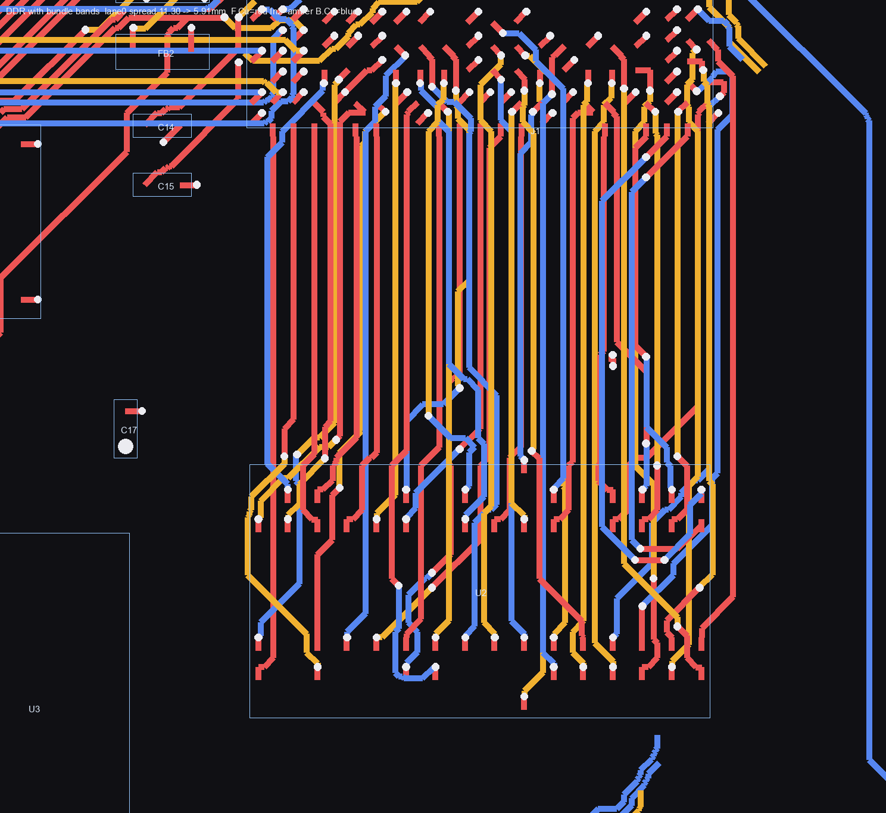

# 186 · RK3506 分阶段重做 — 阶段 2b：同组走廊（bundle band）

`docs/185` §11 写死的下一步是「同拓扑 bundle 布线」，并先留了一件小事：
**把 `net_priority` 从「事后补救」改成「按组占用走廊」**。本篇做的是那件小事，而且做成了
一个可复用的搜索层能力（`route.router.plan(bundle_bands=...)`），不是一条板专用脚本。

结果一句话：**lane0 的长度离散 11.304 → 5.908 mm（−47.7%），总铜长 720.0 → 698.7 mm，
布线耗时 80.6 → 44.5 s，DRC 与已交付板逐项相同（26 条旧账，DDR 未连接 0）。**
lane1 只降 1.8%（6.428 → 6.311），原因见 §6，那是**终端分布**的问题，不是走廊没生效。

---

## 1. 为什么「排序」不够，而「走廊」可以

`docs/185` §7 已经用三组 `net_priority` 实验钉死：**总量守恒之下，总有恰好一条网吃 10–21 mm 绕行**。
排序只能决定「谁付这笔钱」，不能减少总额。

逐网独立 A\* 的第二层问题在于：**每条网只最优化自己**。两条本该并行的线，只要中间有一格便宜，
就会各自散开；离散度不是被谁弄坏的，而是「没人负责让它们一致」的结果。等长要的恰恰是这件事。

所以在**搜索层**引入一个「本组已经有铜的地方更便宜」的量，让组内成员自己往一起走：

* 组内**最短的那条先布**（span 升序）。骨架短，跟随者被拉短；先布最长的那条会让全组继承最坏的绕行——
  这正是 §8.3 拒绝的那个方向：**把整组抬到被绕长的基准上**。
* 布完后把它的铜按 `radius_mm` 半径、按距离线性衰减地画进一张**每层一格一字节**的折扣图；
* 其余成员在走廊内按折扣走，走廊外按原价（`outside > 1` 时加价，见 §5 的负结果）。

折扣只改**代价**。栅格说不能走的地方，谁都还是不能走——走廊买不到违规。

## 2. 代码落点

| 文件 | 改动 |
|---|---|
| `route/grid.py` | `astar(..., guide=None, guide_outside=1.0)`：`guide` 是 `{layer: bytearray(nx*ny)}`，格值 `/255` = 该格步进代价的退还比例；`guide_outside` 是走廊外格子的单价倍数。二者都只进 `nc` 的 `step_cost`，阻挡判据一行未动 |
| `route/router.py` | `plan(..., bundle_bands=None)`：组排序、骨架折扣图构建（`_stamp`）、`_band_guide` 缓存、rip-up 时作废、`stats["bundle_bands"]` 报告 |
| `tests/test_route_bundle.py` | 6 例：组先布 + guide 真被用、走廊不破合法性、四种坏 band 被拒 |

`bundle_bands` 一项的形状：

```python
{"name": "lane0",
 "nets": ["/DDR_DQ0", ..., "/DDR_DM0"],
 "radius_mm": 0.8,      # 走廊半宽，默认 0.8
 "discount": 0.6,       # 走廊内退还 60% 步进代价，默认 0.6
 "outside": 1.0}        # 走廊外单价倍数，默认 1.0（不加价），上限 4.0
```

四条**拒绝而不是忽略**的规则（都是「给了却当没给」会让人误以为建成走廊的情形）：
组内不足 2 网、组里出现板上没有的网名（报名字）、`discount` ≥ 0.95（走廊近乎免费 ⇒ 搜索会为待在走廊里绕远）、
`outside` 超出 `[1, 4]`。折扣精度 1/255 就够：它是偏好，不是几何。

## 3. 实测矩阵（同一脚本、同一基板、同一参数）

基板 = `D:/tmp/_s1d.esc2.kicad_pcb`（`docs/185` 逃逸后的板，50 网、`terminal_override` 取自 `_ddr_esc6.json`）。
三个 band：`clk`(2) / `dqs0`(2) / `dqs1`(2) / `lane0`(9) / `lane1`(9)。

| 变量 | 结果 | 结论 |
|---|---|---|
| 无 band（基线） | 50/50，**80.6 s**，461 ops | 与 `docs/185` 的 free2 一致（lane0 11.304 / lane1 6.428） |
| `discount 0.6 / radius 0.8 / outside 1.0` | 50/50，**44.5 s**，461 ops | **采信** |
| 同参数 + `outside 2.0` | 跑到 85 次回调仍未收敛（DQ2/DQ4/DQ13 反复 `failed` 并进 rip 循环），5 分钟以上 | **否决**，见 §5 |

## 4. 采信版读数（铜长，`add_track` 段长累加，与 `em.length` 同口径）

| 组 | 基线 spread | band spread | 变化 |
|---|---|---|---|
| lane0 | **11.304** | **5.908** | **−47.7%** |
| lane1 | 6.428 | 6.311 | −1.8% |
| DQS0 对内 | 0.422 | 0.422 | 0 |
| DQS1 对内 | 0.895 | 0.831 | −7.1% |
| CLK 对内 | 0.483 | 0.417 | −13.7% |
| 总铜长 | 720.0 mm | **698.7 mm** | −21.3 mm |

lane0 明细（基线 → band）：

```
DQ5 11.331→12.021   DM0 12.049→12.007   DQ3 12.351→13.004   DQ2 14.951→15.258
DQ6 15.440→16.747   DQ4 16.164→17.086   DQ0 16.387→15.025   DQ1 21.997→11.178
DQ7 22.635→12.770
```

关键的一条是 **DQ1 21.997 → 11.178、DQ7 22.635 → 12.770**：§7 里那两条被迫绕行 10 mm 的网，
不是靠重新排序治好的，是靠「走廊里的路更便宜」自己回来的。**同时总长变短**，所以这并不是
「给整组加铜去迁就基准」——那是 §8.3 明确拒绝的做法。

## 5. 负结果：`outside` 一加价就崩

`outside=2.0` 的动机是「让短网主动绕长，追平骨架」。实测立刻劣化：

* **布不通**：`/DDR_DQ2`、`/DDR_DQ4`、`/DDR_DQ13` 多轮 `failed`，进入 sweep + rip-up 振荡；
* **慢**：85 次回调仍未收敛，是采信版（44.5 s）的五倍以上；
* 根因清楚：走廊外全部 ×2 等于 **把「从焊盘走到走廊」的那一段也算成绕远**，而那段是必经的；
  于是搜索宁可挤在走廊口，也不肯走一段「贵」的接入路径，最后谁都布不出来。

所以 `outside` 默认 1.0，只在上限 4.0 之内允许试。**「强制贴骨架」这个目标不能靠加价实现**，
它需要路径模板（§9）。

## 6. lane1 为什么只降 1.8%

lane1 的 9 条网端点分布在 DDR 侧的上下两排，最短路径本身就差 6.4 mm：

```
基线 DQ10 9.985 … DM1 16.413      band DQ10 10.102 … DM1 16.413
```

走廊能做的只是「让它们走同一条道」，**不能让本来就短的那条主动绕长**——这正是 §5 想用加价去解决、
又被证明会崩的事。lane0 之所以有效，是因为它那 11.3 mm 里有 10 mm 是 **DQ1/DQ7 的绕行**（可被走廊消掉）；
lane1 的 6.4 mm 是**终端几何差异**（不可被走廊消掉）。

⇒ 结论要分层写：**band 能消掉「绕行造成的离散」，不能消掉「端点分布造成的离散」**。
后者要靠模板路径 + 蛇形补齐，指标口径仍是 `checks.length_match`（tol_lane 0.5），当前 5.908 / 6.311 都还没达标。

## 7. 落盘与 DRC（副本板，不进库）

为了不动已交付的 `_rl1_s1d.kicad_pcb`，本轮落在 `_rl1_s1d.bb.kicad_pcb`（`D:/tmp/_s1d.esc2` 的副本）：

```bash
cp D:/tmp/_s1d.esc2.kicad_pcb examples/rk3506_som/_rl1_s1d.bb.kicad_pcb
cp examples/rk3506_som/_rl1_s1d.kicad_pro examples/rk3506_som/_rl1_s1d.bb.kicad_pro
env -u PYTHONPATH -u PYTHONHOME python -u _bb_apply.py D:/tmp/_band_on.json   # 461 op，0 rejected
env -u PYTHONPATH -u PYTHONHOME "D:/KiCad/10.0/bin/python.exe" -u D:/tmp/_prune_esc.py \
    examples/rk3506_som/_rl1_s1d.bb.kicad_pcb ./_bb_prune.json                # 48 个只载一层铜的逃逸孔
env -u PYTHONPATH -u PYTHONHOME python -u _bb_apply.py _bb_prune_ops.json      # delete_via ×48
"D:/KiCad/10.0/bin/python.exe" -c "import sys;sys.path.insert(0,'tools');import board_loop as BL;print(BL.refill('examples/rk3506_som/_rl1_s1d.bb.kicad_pcb'))"
"D:/KiCad/10.0/bin/kicad-cli.exe" pcb drc --severity-all --format json -o D:/tmp/_bb_drc2.json \
    examples/rk3506_som/_rl1_s1d.bb.kicad_pcb
```

DRC 结果与已交付板**逐项相同**：

| 项 | 试验板 | `_rl1_s1d`（阶段 2 交付） |
|---|---|---|
| `violations` | 26（`track_dangling 25` + `isolated_copper 1`） | 26（同） |
| `clearance` / `via_dangling` / `hole_to_hole` / `via_in_pad` | 0 / 0 / 0 / 0 | 0 / 0 / 0 / 0 |
| `unconnected_items` | 175，**`/DDR_*` = 0** | 175，`/DDR_*` = 0 |

也就是说 corridor 引导**没有为等长付任何 DRC 代价**。



（62 px/mm，U1 BGA→U2 区域。红 F.Cu / 琥珀 In2.Cu / 蓝 B.Cu，与 `docs/185` 的 `185-ddr-s2a.png` 同配色。）

## 8. 反向失败对照

| 判据 | 去掉什么 | 实测变成 |
|---|---|---|
| 组内先布 + 骨架被复用 | 不传 `bundle_bands` | lane0 11.304（回到基线），`stats["bundle_bands"]` 不出现 |
| 走廊只改代价、不碰合法性 | `rejected_ops` 必须为 0 | band 版 0；单测 `test_the_band_does_not_break_legality` 钉住 |
| 坏 band 必须被拒 | 把校验删掉 | 单测四例分别覆盖「1 网 / 未知网名 / discount=1.0 / outside=9」 |
| 骨架折扣真的生效 | `guide_calls` 应 ≥ 1 | 单测断言；为 0 说明 band 什么也没做 |

## 9. 没做到的，以及为什么下一步是模板而不是参数

1. **lane 级仍未达标**（lane0 5.908、lane1 6.311，tol 0.50）。band 消掉了绕行型离散，剩下的
   **端点分布型离散**走廊消不掉——`outside` 加价试过并否决（§5）。
   真正的「同拓扑」需要**路径模板**：取骨架折线，按法向平移 Δ（Δ 由成员终端间距决定）生成候选路径，
   逐段过精确门，局部冲突用 A\* 补，段数/拐弯序列与骨架一致。这是下一步，本轮没做。
2. **44/50 条网碰 F.Cu**（`docs/185` §11 第 2 条）状态未变：band 不改变用层偏好。要回内层必须先修
   A\* 栅格门与 emit 精确门的口径分裂。
3. 试验板没做 §8.2 的圆弧蛇形（对内仍是 0.422 / 0.831 / 0.417）。要把 band 版做成交付板，
   应该在 band 布线之后跑一次 `tune_board(style="arc")`——顺序不能反：蛇形只会加长，先加铜再改走法就白调了。

## 10. 复现

```bash
# 布线（两分钟以内）
env -u PYTHONPATH -u PYTHONHOME "D:/KiCad/10.0/bin/python.exe" -u _band_try.py D:/tmp/_band_on.json band 0.6 0.8
env -u PYTHONPATH -u PYTHONHOME "D:/KiCad/10.0/bin/python.exe" -u _band_try.py D:/tmp/_band_none.json none
# 读数对比（同一把尺子：ops 里 add_track 段长累加）
env -u PYTHONPATH -u PYTHONHOME python _bb_cmp.py D:/tmp/_band_none.json D:/tmp/_band_on.json
# 单测
python -m pytest tests/test_route_bundle.py -q          # 6 passed
python -m pytest tests/test_route.py tests/test_route_fixed.py \
    tests/test_45_corners.py tests/test_route_bundle.py -q   # 124 passed
```

`_band_try.py` / `_bb_cmp.py` / `_bb_apply.py` / `_draw_bb.py` / `_bb_prune*.json` 均为 `_` 前缀取证产物，按仓库约定不入库。
