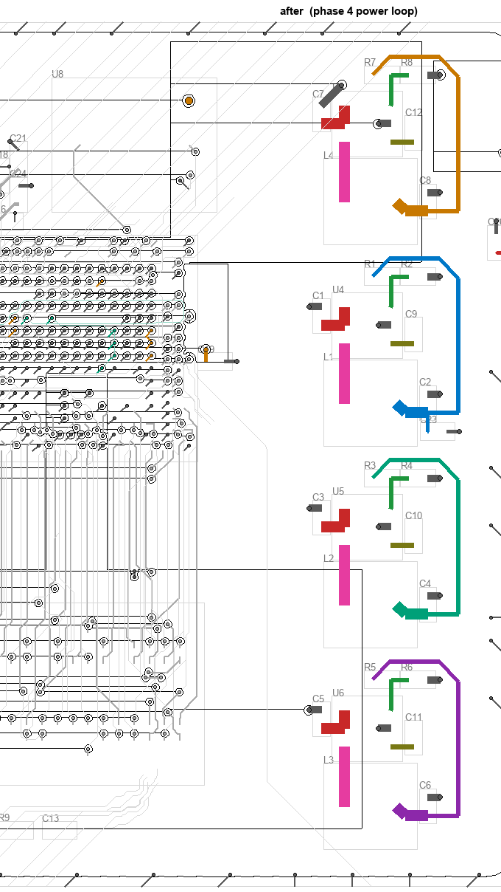

# 阶段 4 —— 电源区：每个 buck 单元的十五条腿，一条一条画到板上

`189 §7` 与 `190 §10` 都留了同一件欠账：*电源区不是布局问题，是没画*。四个 buck 单元已经搬到东侧竖带、`Cin/Cout/Boot/分压` 也都贴着各自 IC 站好了（`182`），但那一带**几乎没有铜**——DC-DC 的输入回路、开关节点、输出回路、自举、反馈、地回流，一条都没有。

本文记录把这件事做成**工具能力**的过程，以及它在真板上真正落下去之后的读数。工具只**测量与规划**，铜仍然由调用方交给 `board_edit` 写、由官方 `ZONE_FILLER` 灌——与 `board_decap_sites` 同一条界线。

本轮不升版本、不进 CHANGELOG（沿用 181–191 的先例）；新增一个工具，工具数 **261 → 262**。

## §1 结论先行

**新模块** `src/pcb_agent_mcp/power_loop.py`（约 900 行，零新依赖）：

| 层次 | 内容 |
|---|---|
| `cells(board, vin_net, gnd_net)` | 按 **`/SW_<ref>`** 找功率 IC，再在 SW 网上找「另一侧不是控制网、也不是 GND」的 footprint 当电感。单元带 `body`（磁体盒 + 其焊盘矩形），供「铜不许从电感中间穿过去」用 |
| `_legs_for(cell, ...)` | 每个单元 **15 条腿**：`vin_ic` / `vin_cap` / `sw` / `out` / `boot_bs` / `boot_sw` / `vin_rail` / `out_rail` / 4×`gnd_*` / `fb_div` / `fb_top` / `sense`。每条带 `width_mm`、`target_mm`，以及 **`straight_mm`**（两焊盘直线距离 —— 任何路由器的地板，也是「这不是布线问题」的证据） |
| `_route` / `_route_any` | 只用 `D._route45`（0/45/90/135；无圆弧、无直角折返），逐级放宽：直连 → 0.25 栅格 → escape+0.50 栅格；每段再过一遍磁体否决 |
| `_plane_leg` / `_via_here` | 轨到自家灌注面的那条腿。先问「面就在焊盘下吗」，再在 `reach` 内 8 向 × 0.25 步搜索**可打孔且净空全叠层**的落点 |
| `plan()` | 返回 `{cells, ops, refused, rules, summary}`。`ops` 只有 `add_track` / `add_via` 两种，直接可交给 `board_edit` |
| `board_power_loop`（`tools.py`） | `mode=measure` 只报腿、不路由；`mode=plan`（默认）出 op。两种都 `derived=True` + `_NOT_WRITTEN`：**不写板** |

**真板读数**（`examples/rk3506_som/_rl1_s1d.bb.kicad_pcb`，`plan()` 140–166 s）：

| 量 | 值 |
|---|---|
| 单元 / 腿 | 4 / 60 |
| `closed` / `blocked` | **48 / 12** |
| 铜 | **76 段 track + 16 个 via = 92 op** |
| `board_edit` 前置 | `precheck.clearance.violations` **0**，`clearance_no_worse` **0 → 0**，`verdict = writable_with_1_undecided`（唯一未决是 `process_declared`，它不是通过） |
| 落盘 | `apply_plan` ok，**92/92 后置条件逐条验证**，`token_identity` 通过 |
| 重灌 | 官方 `ZONE_FILLER` 灌出 **5** 个 zone |
| **未连接** | **176 → 128（−48）**，正好等于 48 条闭上的腿 |
| **DRC** | **25 → 25**，类型仍是 `track_dangling` 25，**零新增** |
| 角度 | 出现过的段角只有 `0/45/90/135`；拐点转角全部 ≤ 90°（无锐角、无 180° 折返） |
| 磁体 | 新增 76 段里穿过电感本体的 **0** 段 |
| 孔位 | 16 个孔：不在焊盘内 **16/16**、不在电感身下 **16/16**、全叠层净空不足 **0** |

## §2 途中抓到的一条真缺陷：通孔只问了它站的那一层

第一次跑 `apply_plan` 时，前置闸门拒绝了这次写入：

```
this plan takes the board from 0 to 1 different-net pair(s) closer than 0.1 mm;
tightest is 0.0 mm at [26.883, 33.8961]
```

按位置看，92 个 op 里最近的一个距该点 7.78 mm（op 的 x 范围 33.71–41.53，冲突点 x = 26.883），第一反应是**前置检查的假阳性**。把两份文档都摊开来逐对算，结论相反：那条 `/LCDC_CLK` 是 In2.Cu 上一条从 (26.883, 33.8961) 到 (37.983, 44.9961) 的 45° 长线，而计划里有**一个新打的 /GND 通孔正好落在 (33.71, 40.66)**：

```
old  track /LCDC_CLK In2.Cu (26.883,33.8961)-(37.983,44.9961) half 0.05
NEW  via   /GND      *      (33.71,40.66)                     half 0.15
gap  -0.155 mm
```

`at` 字段报的是**先入表那一项（老线）的起点**，所以位置读数看起来在 8 mm 之外——**闸门是对的，报位置的那一列是让人误判的地方**。

根因两处，都是同一句话：**通孔是穿过全叠层的，净空必须对每一层都成立，不能只问面所在的那一层。**

1. `decap_sites._gnd_escape` 的 `allcu = layers or _layers_of(board)`：`power_loop` 传 `layers=["F.Cu"]`（本意是「这条 escape 的走线在 F.Cu」），函数却把它当成了**要检查净空的层集**。
2. `power_loop._via_here` 的 `for _f, ls in fills: _clearance_at(..., ls)`：`ls` 是**这一块灌注面所在的层**，于是打了孔只问了 In1。

改法（两处都改，避免下一次从另一个入口漏过去）：

- `_gnd_escape`：`allcu = _layers_of(board) or (layers or [])`，注释写明「`layers` 是走线层，不是孔要清的层集」；
- `_via_here`：新增 `_stack_layers(board)`（按板缓存全叠层），净空按全叠层算；拒绝文案改为**点名层与网**——`the annulus has -0.005 mm to seg of /LCDC_CLK on In2.Cu`。
- `power_loop` 的 `_ground_legs` 不再传 `layers=[_LAYER]`（传 `None`）。

改完的**唯一变化**是那个孔从 `(33.71, 40.66)` 挪到 `(35.421, 41.721)`；四条拒绝理由与 48/12/76/16 **逐格不变**——这正是想要的：修一条判据不该改结论。

`_clearance_at` 的 docstring 早就写着「一个孔属于它穿过的每一层，所以调用方传整个叠层」，这次是调用方没听。

## §3 十二条「打不开」的腿，每条都点名真正的原因

12 条 `blocked` 分三类，文案不合并：

| 类 | 条数 | 例子（真板原文） |
|---|---|---|
| 布局账 | 4× `boot_sw` | `a legal run exists but is 13.60 mm long (budget 6.00): the parts are placed so the switch node has to go around them` —— 自举电容的 SW 焊盘在 IC 远侧，合法绕行 13.6 mm。**它不是布线问题**：`straight_mm` 都在预算内，绕的是别的东西 |
| 面不存在 | 3 | `this board defines no zone for /+0V9_CPU at all, so the rail has no plane to reach: closing it means a bus across the board, which is a layout decision`（`/+0V9_LOGIC` 同） |
| 面够不着 | 5 | `the nearest /+1V35_DDR flood is 2.78 mm away: a bus has to be drawn there`；`/+5V_IN`：`5.19 mm`（U7）/ `no flood of /+5V_IN within 8.0 mm`（其余三个）；`/+3V3`：`0.32 mm apart but every point of it within 2.0 mm of this pad is under L4's body: a via may not stand there` |

最后一条是 191 那件事的另一面：**距离近不等于能打孔**。这一轮把它从「decap 站点的问题」扩到「轨的问题」，`_plane_leg` 现在统计每个候选被哪条规则吃掉（`blocked_by` / `candidates` / `blockers` / `reach_mm`），按**最多者**生成文案，并保留示例点。

`placement_note`（每单元一句）也补了两条真账：

```
the switch node is 3.10 mm, over the 2.00 mm budget: the inductor sits that far
from the switch pin, and no router shortens a loop - this is a placement change,
not a routing one;
the output sense line is 13.90 mm against a 2.00 mm target, and 7.66 mm of that
is the straight gap between the divider tap and the output capacitor: the tap
belongs at the cap, so the length is where the divider sits
```

`sense` 取在**输出电容焊盘**而不是电感焊盘：电感焊盘唯一的出路是两焊盘之间那 ~1 mm 空档，正是上一版被否掉的那条线。13.90 里有 7.66 是分压器到输出电容的直线距离，所以它是**分压器的位置**的账，不是走线的账。

## §4 三条判据各自的反向失败对照

「宁可报错不给错答案」在这里的落法是：每条新判据都有一个**把正确实现改坏就必红**的对照。

**通孔必须过全叠层**（`TestThroughVia`，3 例）：

- 正例：GND 面上、In2.Cu 上每 0.5 mm 一根异网竖线（间距 0.5 − 0.1 − 0.1 = 0.3 mm 空气，一圈 0.3 mm 的孔环用不上）⇒ `_gnd_escape` 必须返回 `None`；
- 反例（同一块板、同一次调用、去掉 In2 的线）⇒ 必须找到孔，且 `clearance_mm ≥ 0.15 + 0.15`；
- 文案：`_via_here` 的拒绝必须同时带上网名与层名（`/LCDC_CLK` + `In2.Cu`）——只说 `clearance` 会把人送去查 F.Cu，而 F.Cu 正好是没问题的那一层。
- **突变检验**（把 `allcu` 改回 `layers or …`）⇒ 正例红，且失败输出正是那个错答案：`{'via_at': [7.65, 20.96], …, 'layer': 'In1.Cu'}`，一条穿过线栅的孔被放行。

**轨到面的拒绝要点名真正阻塞者**（`TestPlaneRefusal`，5 例，191 建立）：面在回收内但全在电感身下 ⇒ 必须说 `L9's body`、不许说「画条母线」；有 zone 无灌注 ⇒ `never filled`；根本没有 zone ⇒ `defines no zone`，两件事分开。

**距离一律从 stub 点量**（191 建立，本轮修正调用）：`_fill_shortfall(board, net, pad, stub_mm=, probe=)` —— 上一版把 `max(stub, reach)` 当 `stub_mm` 传进去，量出来的是「从离焊盘 2 mm 的点算起」；修正后 `/+5V_IN` 从 3.84 变 **5.19 mm**（焊盘中心 5.84 − 0.65），并补了一对反向对照（2.35 对 3.00）。

测试面：`tests/test_power_loop.py` **28 → 31 例**（新增 `TestThroughVia`），`test_decap_sites.py` 40 例，`test_tools.py` + `test_tools_profile.py` ⇒ **105 passed / 76.8 s**。

## §5 真板落铜：数字与验证

链路：`P.plan()` → `E.propose(..., {"engine": True, "precheck_clearance_mm": 0.1})` → `E.apply_plan(confirm=True, options={"precheck_clearance_mm": 0.1})` → `L.refill()`（官方 `ZONE_FILLER`）→ `L.count_unconnected()` → `L.drc()`。

**没有** `allow_new_violations`：闸门是通过的，不是被绕过的。

```
before: unconnected 176, violations 25 {track_dangling: 25}
after : unconnected 128, violations 25 {track_dangling: 25}
```

`176 − 128 = 48` 与 48 条闭上的腿完全对齐；DRC 一条没多、一条没少（`track_dangling` 是 181 起就有的历史债，与本次无关）。

## §6 出图



左：改动前；右：改动后（F.Cu 粗线，内层细线，灰框为 courtyard，空心框为 zone 轮廓）。四个单元的输入/开关/输出/自举/反馈/地回流都成形了，整体保持竖带分区，没有一条线从电感框中间穿过去。

## §7 这一轮没有做的

1. **`+5V_IN` 的 In3 面扩成竖带母线**（4 个 `vin_rail` 里 3 个死在这里）；`+0V9_CPU` / `+0V9_LOGIC` 的 zone 在板文件里**根本不存在**，得先画轮廓再灌注；`+1V35_DDR` 面没覆盖 U6 区；`/+3V3` 面被 L4 挡住。四条都是**面**的事，不是腿的事。
2. **`boot_sw` 的 13.6 mm** 是布局账，改法是把自举电容转 180°（SW 焊盘朝 IC），属阶段 1 类的布局动作。
3. `hole_in_pad` 9 / 旧 `via_in_pad` 9 / `copper_under_magnetics` 1 / 5 处半路由 / 旧锐角 / `track_dangling` 25 全在阶段 2/3 的欠账清单里，本轮不碰。
4. 0.2 mm 余量（`ruleset.precondition.CLEARANCE_FLOOR_MM`）是否收窄仍是**需要用户定**的事，工具不自己放宽。
